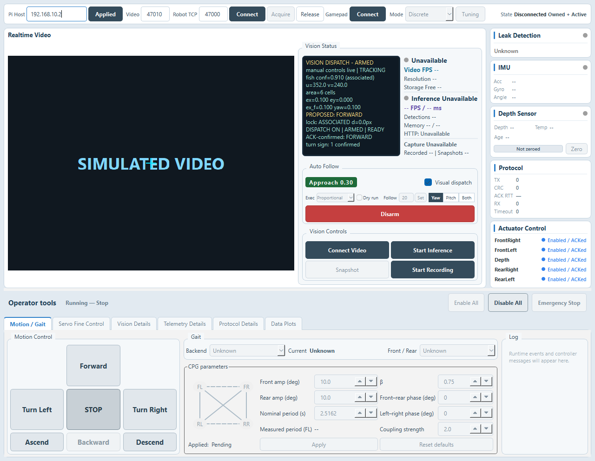
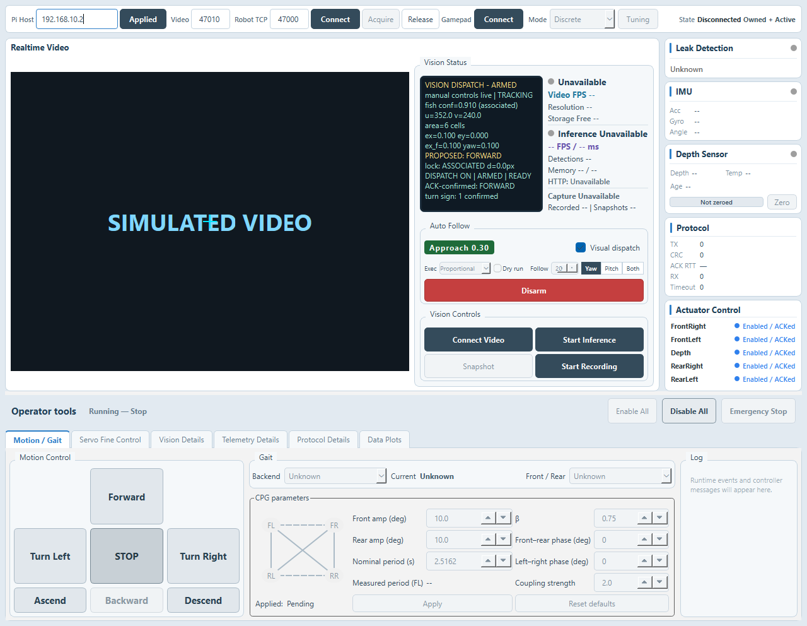
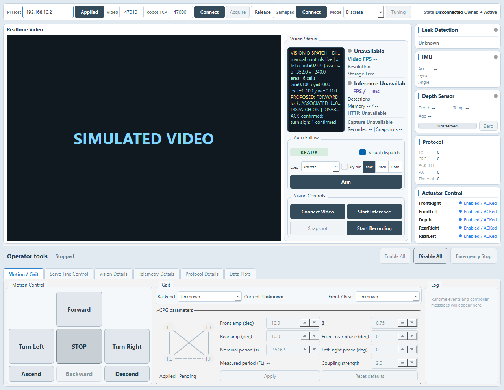
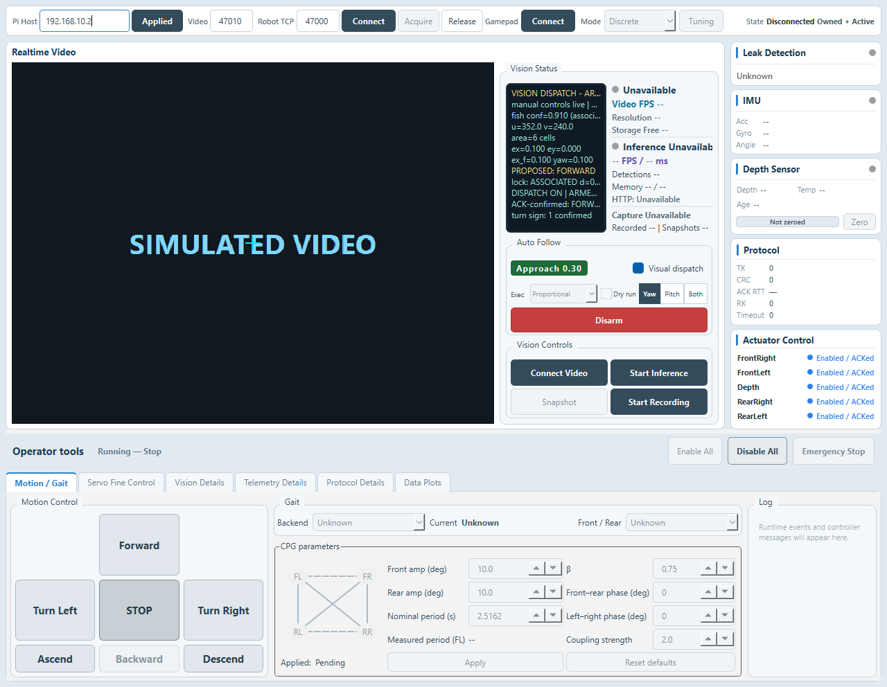
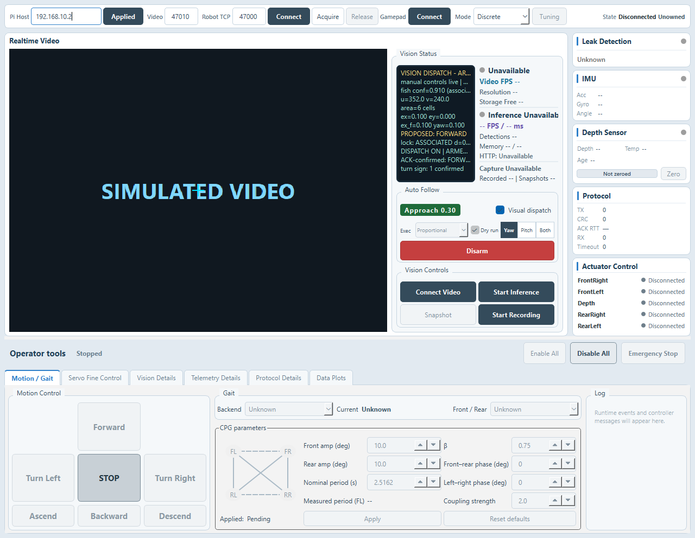

# Visual approach / stop (Task20)

`Exec` defaults to `Discrete` each launch. Select `Proportional` while disarmed and with no unconfirmed STOP, enable Visual dispatch, and Arm explicitly. `Dry run` follows the same area/state logic without calling controller send APIs; it bypasses hardware eligibility, while Pitch/Both still require valid calibrated depth.

The existing visual command policy selects Forward, Turn Left/Right, or Ascend/Descend. The proportional executor maps those commands to throttle/turn/pitch, refreshes the latest input at each evaluation, and waits for Start ACK before streaming. No target retains the preceding setpoint for the existing 1.5 s grace. LOST stops while keeping Arm; STALE, inference off, manual input, rejected/unknown Start, or firmware setpoint timeout stop and disarm. Depth safety checks both pending and current pitch and bypasses ordinary switching dwell.

Only the selected target's area is filtered, once per new frame. Video catch-up preserves dwell and missing-area timing. Continuous missing area over 500 ms becomes LOST. ARRIVED stops and remains armed, including eccentric targets. Initial Arm/reacquisition with area at least A_stop enters ARRIVED immediately without Start. Resume requires area below A_resume for its dwell, an accepted STOP at least 1000 ms old, and actual STOPPED.

Visual proportional configuration is independent of gamepad settings and saved under `Visual/Approach/v1`. All defaults are provisional:

Task20b adds `Follow` to the compact Exec row: an integer stop-area shortcut (5–200 cells, default 20). Larger values stop closer; this is an area proxy, not meters. Changing Follow sets A_slow=0.4×A_stop and A_resume=0.7×A_stop, preserving decimals, saves the same visual settings, and emits the existing CONFIG event. Tuning shares the stop-area value/range and synchronizes the displayed Follow value when saved; independent Slow/Resume edits remain valid until Follow is changed again. Follow is editable only in Proportional while disarmed with no unconfirmed STOP. Exec/Dry run/Follow/axis controls stay on one row, with 20 px control heights and 4 px Exec-label spacing.

Task20c replaces immediate Follow submission with an input and `Set` button. The integer input has no step buttons; only Set or Enter applies the existing threshold/settings/CONFIG update. UI refresh preserves a focused draft, and Set keeps input focus during the click. Both controls use the same Proportional/disarmed/no-pending-STOP edit gate and stay on the existing row.

Measured period (FL) now displays the mean of the most recent one to three valid cycles. STOP/state changes reset phase tracking and the startup-cycle discard without clearing measured cycles; a parameter-version or backend change clears them. The initial startup cycle remains discarded. A running value displays as `2.004 s`, a retained non-running value as `2.004 s (last)`, and no measurement as `--`. Existing complete monitor resets still reset its recording context. This changes monitoring/presentation only.

Task20c focused Follow and synthetic schema2 period tests pass; a fresh Release build and the full regression passed 40/40 once in 74.97 s. New portable: `D:\RoboBeetleConsole-portable-task20c-follow-set-period-2026-10-12\`; EXE SHA-256 `C630713CBB422210019A4C8911102DFFFF452B04A6CE068AB481AEC28497D5C6`. Evidence: `D:\RoboBeetle-results\task20c-follow-set-period-2026-10-12\`.

Task20d fixes Start ACK evaluation ordering: Remote emits commandTerminal before applying the accepted command, so synchronous visual reevaluation tried to stream while proportionalActive was still false. The proportional terminal branch now queues timerTick for the next event turn. Remote ACK ordering and the discrete branch remain unchanged. One real-Remote/loopback-gateway/visual-session regression reproduced disarm, STREAM_REJECTED, missing input and STOP before the fix, and passes afterward. The existing gamepad-ownership test now drains that queued startup evaluation before taking its count baseline; its assertions are unchanged.

Task20d Release build succeeded; the full regression ran once (39/40), followed by the single failed UI fixture target passing after the event-turn baseline adjustment (1/1). All 40 targets are verified. New portable: `D:\RoboBeetleConsole-portable-task20d-start-ack-order-2026-10-12\`; EXE SHA-256 `D97D7333603A605A3D704261E6F42A97746F742D02AC1AD80FBCC204AABC5075`. Evidence: `D:\RoboBeetle-results\task20d-start-ack-order-2026-10-12\`. No approach/safety rule or firmware/gateway changes; no hardware operation or merge.

Task20b adds one small threshold/persistence test (RED missing Follow control, then GREEN). A fresh Qt 6.11.2 / MinGW 13.1 Release build and the full existing regression passed 40/40 once, in 75.13 s. No approach policy, executor, transport, or safety logic changes are included. The updated portable artifact is `D:\RoboBeetleConsole-portable-task20b-follow-distance-2026-10-12\`; EXE SHA-256 is `2DB99408E428F93D826A526EA9881692F32945AF76FCA4A4A23D953F8CFF0457`. Full evidence is in `D:\RoboBeetle-results\task20b-follow-distance-2026-10-12\`.

| Parameter | Default |
|---|---:|
| alpha_area | 0.30 |
| A_slow / A_resume / A_stop | 8 / 14 / 20 cells |
| arrive / resume dwell | 1000 / 1000 ms |
| t_max / t_min / t_turn_min | 0.60 / 0.15 / 0.30 |
| k_turn / k_pitch | 1.0 / 0.50 |
| max_scale / turn_gain | 1.0 / 1.0 |
| pitch_limit / slew_per_second | 10 degrees / 2.0 |

Throttle decreases linearly between A_slow and A_stop; turns retain t_turn_min so differential turning still has propulsion. Turn Left maps to negative turn, which reduces the left side under the existing firmware formula. Ascend maps to positive pitch, which makes the front-axis offset negative. Both retains horizontal priority and a single nonzero steering axis.

Visual ownership prevents the gamepad mapper from treating a visual session as its own. Manual takeover stops visual execution and waits for STOPPED and fresh centered gamepad input. No arbiter or token framework is added.

The logger always writes `visual-csv-v7`, preserving the first 48 columns and appending 9 columns: `exec_mode,dry_run,area_f,approach_state,throttle,turn,pitch_setpoint,actually_submitted,approach_event`. Discrete extensions are blank. Values join existing frame/dispatch records; no periodic approach rows are added. Sparse events are ARRIVED_ENTER/EXIT, AREA_MISSING_LOST, SETPOINT_TIMEOUT, START_FAILED, STREAM_REJECTED, and CONFIG. Setpoints use protocol units (0..1000 or -1000..1000); IMU `pitch` stays separate. Submission status describes a successful input/request submission, not proof of physical motion. Existing v6 recordings and Task17 named-column reads remain valid.

## Verification and boundaries

New tests cover pure mapping/area transitions, continuous streaming and safety, Dry run with zero controller calls, ordinary correlated Remote Start/STOP, unified CSV, and UI ownership/selector behavior. Existing behavioral tests are retained; only CSV schema/version/count assertions change in visual_csv_logger_tests.cpp, main_window_tests.cpp and main_window_visual_dispatch_tests.cpp. The two additional files were explicitly authorized after the first regression identified their old format checks. Release build succeeded; the full run passed37/40, then all3 format-only failures passed after the approved assertion update. All40 targets are verified; only failed targets were repeated. Task17 compatibility used74 synthetic sampled frames with identical v6/v7 depth joins and does not claim physical synchronization.

Fake-controller native previews below expand Operator tools at 1280×992; the manifest records zero robot-control writes. No hardware connection, firmware change, Pi deployment, burn, or robot motion is part of this implementation. Compatibility targets the existing Task19 firmware/gateway `8f1aedb` protocol.

## Operator acceptance (pending)

1. On a dry desktop with unloaded servos, select Proportional + Dry run. Move a real toy forward/back (not a screen recording) and inspect area_f, throttle, and APPROACH/ARRIVED in CSV.
2. Turn Dry run off and repeat; verify decreasing servo amplitude, arrival stop, and restart after moving the toy away.
3. Trigger target occlusion, inference off, manual keys, gamepad input, depth boundaries, and network loss individually.

Area is a coarse proximity cue, not distance. A large/truncated target may have area near 1 cell, causing continued t_max propulsion. Keep operator STOP ready and observe that case explicitly. No additional approach timeout is included. Default t_max=0.60 also limits same-side turn amplitude to 0.6 of discrete full-throttle turning, so response is intentionally weaker.

## Previews

Latest Task20c Exec-row preview (1280×992, fake controller, zero real writes; [manifest](task20c-manifest.json)):

Task20b preview retained for review history ([manifest](task20b-manifest.json)):

The original Task20 previews below are retained as historical review evidence.

