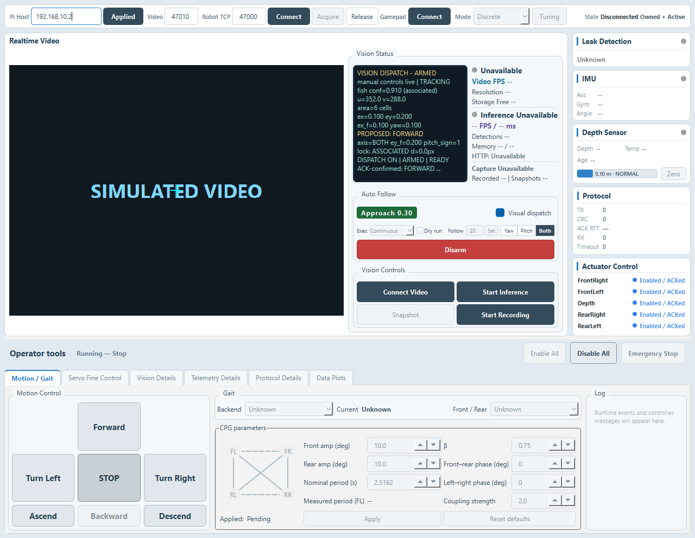

# Task 21: Continuous visual execution

Visual Exec now offers Discrete, Proportional (scheme A), and Continuous. It still
starts in Discrete and does not persist the selected execution mode.

Continuous reuses the existing approach area filter, arrival/recovery dwell,
proportional dispatch lifecycle, depth safety, Dry run, Follow, and CSV schema.
It maps the existing filtered `ex_f` and `ey_f` directly to steering:

```
r(e) = sign(e) * clamp((abs(e) - e_dead) / (e_full - e_dead), 0, 1)
turn = turn_sign * r(ex_f)
pitch = -pitch_sign * r(ey_f) * k_pitch
throttle = max(area_throttle, t_turn_min * abs(turn))
```

Yaw suppresses pitch; Pitch suppresses turn; Both allows both simultaneously.
ARRIVED produces zero throttle, turn, and pitch. Surface suppresses positive
pitch and SoftFloor suppresses negative pitch. An already submitted or executing
forbidden pitch requests STOP while retaining arm; HardLimit requests STOP and
disarms. Continuous bypasses the discrete steering selection and its mode dwell.

Visual approach Tuning adds provisional `e_dead=0.05` and `e_full=0.40` under the
existing `Visual/Approach/v1` settings group. Both are included in CONFIG events.
CSV remains v7/57 columns and records `CONTINUOUS`. When unarmed with no pending
STOP, frame rows leave area, approach state, throttle, turn, and pitch empty;
execution mode and Dry run remain recorded.

Validation: Release build; 41/41 Qt CTest targets passed in one full regression
(77.58 seconds). Existing Discrete and Proportional behavioral tests were not
modified. New focused tests cover the mapping, axes, signs, saturation, weighted
turn floor, depth clipping/STOP, each-cycle refresh, CONFIG, and inactive CSV.
Independent read-only source review found no actionable defects.

The Windows native fake-controller preview is 1280 × 992, with zero robot-control
writes. The portable executable passed a three-second startup check with only
Windows directories on PATH and no robot/video TCP connections.



Operator acceptance still required:

- Dry run: turn/pitch vary continuously with target position and have correct signs.
- Dry run off, Both: diagonal target offset gives simultaneous nonzero turn/pitch.
- Surface, target above: pitch is zero.

Desktop checks cannot establish closed-loop tracking. Gains remain provisional
until pool testing. No firmware/gateway changes, hardware connection, or merge
are part of this delivery.
